# HushWave: theory and design

This file is generated. Edit `docs/THEORY.template.md`, then run `make docs`. Every number below is computed by code from `src/hushwave/config.py`, `theory.py` and `windows.py`.

All citations are marked **verify before submission**.

## 0. Decisions that differ from, or sharpen, the brief

1. **Frame-length ablation uses 16 / 32 / 64 ms, not 20 / 32 / 64 ms.** The FFT we write is radix-2, so N must be a power of two. 20 ms at 16000 Hz is 320 samples, which is not.
2. **STOI sampling rate.** The brief says PESQ-WB and STOI both assume 16 kHz. PESQ-WB does require 16 kHz. STOI is defined on a 10 kHz internal rate, so the `pystoi` package resamples internally (verify in M7). 16 kHz input is still correct for both.
3. **MMSE-LSA gain can exceed 1.** Derived in section 7.3. For xi = 1 and gamma = 0.01 the raw gain is 5.31. We clip G3 to at most 1, so "0 < G <= 1" holds for every rule.
4. **Latency is not one number.** Section 4.4 derives a per-sample delay between 256 and 511 samples. M6 fixes and measures the engine's constant delay.
5. **Bias constants are calibrated, not copied.** Section 6 explains why the minimum-statistics bias factor is computed by simulation in M4 for our exact smoothing constants.

## 1. Problem and signal model

Observed signal: y[n] = x[n] + d[n], with x clean speech and d additive noise, independent of x.

Frame the signal, window it, take a DFT: Y(n,k) = X(n,k) + D(n,k), frame n, bin k = 0..N/2.

Model assumptions, used throughout:

- X(n,k) and D(n,k) are zero-mean complex Gaussian with variances lambda_x(n,k) and lambda_d(n,k) (the speech and noise PSDs in that frame and bin).
- X and D are independent, and different (n,k) cells are independent.
- Define the **a priori SNR** xi = lambda_x / lambda_d and the **a posteriori SNR** gamma = |Y|^2 / lambda_d.

The enhancer estimates lambda_d, then xi, then a real gain G(n,k) in (0, 1], and outputs X_hat = G * Y. The noisy phase is kept. Under the Gaussian model the MMSE estimate of the phase is the noisy phase (Ephraim & Malah 1984).

These assumptions are approximate for real speech and noise. Where they matter, LIMITATIONS.md will say so.

## 2. System block diagram

```mermaid
flowchart LR
  A["Input x[n], 16000 Hz"] --> B["High-pass biquad, 80 Hz"]
  B --> C["Optional notch bank, 50 Hz harmonics"]
  C --> D["Frame N=512, hop H=256, sqrt-Hann analysis"]
  D --> E["FFT"]
  E --> F["Noise PSD tracker"]
  E --> G["gamma = |Y|^2 / lambda_d"]
  F --> G
  G --> H["xi: decision-directed"]
  H --> I["Gain rule G1, G2 or G3, floor, smoothing"]
  E --> J["Multiply: G * Y"]
  I --> J
  J --> K["IFFT, sqrt-Hann synthesis, overlap-add"]
  K --> L["Output y_hat[n]"]
```

## 3. D1: sampling frequency and signal acquisition

### 3.1 Why fs = 16000 Hz

| Parameter | Value | Reason |
|---|---|---|
| Sampling rate | 16000 Hz | Nyquist = 8000 Hz covers the fricative energy of speech, which extends to about 8 kHz; 8 kHz sampling (telephone band) would cut it off |
| PESQ-WB | needs exactly 16 kHz | ITU-T P.862.2 wideband mode |
| STOI | 16 kHz input accepted | resampled internally to its own rate (verify in M7) |
| Cost | modest | doubling to 32 kHz would double compute for little extra speech content, since speech energy above 8 kHz is small |
| Microphone path | feasible | I2S MEMS microphones and laptop codecs both offer 16 kHz |
| Word length | 16-bit PCM files, float64 inside | no overflow or rounding accumulation inside the pipeline |

### 3.2 Quantization noise

For a uniform N-bit quantizer with step delta and a sine of amplitude 2^(N-1) delta (full scale), the signal power is A^2/2 and the quantization noise power is delta^2/12. The ratio is

SQNR = 10 log10(1.5 * 2^(2N)) = 6.02 N + 1.76 dB.

For N = 16 this is **98.1 dB** at full scale. Quiet signals lose dB-for-dB:

| Level below a full-scale sine (dB) | 8-bit | 12-bit | 16-bit |
|---|---|---|---|
| 0 | 49.9 dB | 74.0 dB | 98.1 dB |
| 20 | 29.9 dB | 54.0 dB | 78.1 dB |
| 40 | 9.9 dB | 34.0 dB | 58.1 dB |
| 60 | -10.1 dB | 14.0 dB | 38.1 dB |

A speech recording 40 dB below a full-scale sine has 58.1 dB SQNR at 16 bits. That is far above the SNRs we study (-5 to 15 dB), so quantization noise is negligible. At 8 bits the same level gives only 9.9 dB, which is comparable to those SNRs, so an 8-bit path would matter.

The empirical check (rounding a near-full-scale sine and measuring the error) is in `tests/test_theory.py`.

### 3.3 Aliasing

Sampling at fs folds a tone at frequency f to

f_alias = |f - fs * round(f / fs)|, which lies in [0, fs/2].

Demonstration (`scripts/make_aliasing_figure.py`, figure `results/figures/d1_aliasing.png`): a two-tone signal with tones at 1000 Hz and 11000 Hz sampled at 48000 Hz is decimated by 3 to 16000 Hz.

- The 11000 Hz tone is above the new Nyquist. Predicted alias: 5000 Hz.
- Plain sample dropping: the alias sits at **0.0 dB** relative to the genuine 1000 Hz tone. It is indistinguishable from real signal.
- With a 255-tap linear-phase FIR low-pass (cutoff 7200 Hz) applied first: **-68.1 dB**.

The FIR is a library design used only for this demonstration. It is not one of the algorithms that earn D2 marks.

### 3.4 Where anti-aliasing happens in the real chain

Anti-aliasing in the live demo is done inside the microphone path, before our code sees any sample. A laptop sound-card codec typically uses an oversampling converter: a simple analog filter, a high-rate ADC, then a sharp digital decimation filter inside the codec. We do not have a datasheet for this laptop's codec, so this statement is general knowledge, not a measurement (verify for the specific hardware if asked). Our software never decimates live audio. The only decimation in the project is the demonstration above and any resampling of files, which uses a proper anti-alias filter.

### 3.5 Signal acquisition and generation

- **Clean speech:** LibriSpeech utterances (16 kHz source). Source URL, checksum and license are verified in M3 before use.
- **Synthetic noise:** white, pink, 50 Hz hum with harmonics, babble from summed utterances, amplitude-modulated and transient noise, all from seeded generators.
- **Real noise:** DEMAND (verify in M3) and our own fan and corridor recordings.
- **Mixing:** section 8.

## 4. Framing, windows and WOLA

### 4.1 Parameters

Frame length N = 512 samples (32 ms), hop H = 256 samples (16 ms), 50 % overlap, bin spacing fs/N = 31.25 Hz, 257 one-sided bins.

Why 32 ms: speech is quasi-stationary over roughly 20 to 40 ms, and the frame must also resolve pitch harmonics (31.25 Hz spacing against a 100 to 250 Hz fundamental). The ablation in M8 covers:

| Frame (ms) | Samples N | Hop H | Bin spacing (Hz) | Bins | Max latency (ms) |
|---|---|---|---|---|---|
| 16 | 256 | 128 | 62.500 | 129 | 15.9 |
| 32 | 512 | 256 | 31.250 | 257 | 31.9 |
| 64 | 1024 | 512 | 15.625 | 513 | 63.9 |

### 4.2 Why sqrt-Hann at both analysis and synthesis

Periodic Hann: w_H[n] = 0.5 - 0.5 cos(2 pi n / N). Its square root is w[n] = sin(pi n / N).

With analysis window w, synthesis window w, and overlap-add, a frame-shift of N/2 gives perfect reconstruction when the sum of w^2 over all frames is constant:

w^2[n] + w^2[n + N/2] = sin^2(pi n / N) + cos^2(pi n / N) = 1.

So analysis-times-synthesis windowing is the Hann window, which satisfies COLA at 50 % overlap, and no gain correction is needed. This is the Princen-Bradley-style condition. M2 verifies it numerically to better than 1e-12.

Why split the Hann between analysis and synthesis: after the gain is applied, the synthesis window smooths frame-to-frame discontinuities that gain changes create, and both stages see the same taper.

### 4.3 Leakage numbers (measured by `windows.window_metrics`)

| Window | Equivalent noise bandwidth (bins) | Main lobe, null to null (bins) | Peak side lobe (dB) |
|---|---|---|---|
| sqrt-Hann (sine) | 1.2337 | 3.0 | -23.0 |
| Hann | 1.5000 | 4.0 | -31.5 |

The sqrt-Hann has a narrower main lobe (93.8 Hz null to null at our bin spacing) and higher side lobes than Hann. We accept the side lobes because the gain is smooth across bins, and the narrower main lobe keeps harmonics separate.

### 4.4 Latency

Frame j covers samples [jH, jH + N). Sample n is last touched by frame j = floor(n / H), which is complete once input sample jH + N - 1 has arrived. So the delay between input sample n and its final output is

N - 1 - (n mod H) samples,

between N - H = 256 samples (16.0 ms) and N - 1 = 511 samples (31.9 ms). Compute time adds to this. M6 fixes the engine's constant delay and measures end-to-end latency on the real audio path.

## 5. Pre-filter: 2nd-order Butterworth high-pass, our own biquad

Analog prototype H(s) = s^2 / (s^2 + s/Q + 1), Q = 1/sqrt(2).

Bilinear transform with pre-warping: K = tan(pi fc / fs), and s = (1 - z^-1) / (K (1 + z^-1)). Multiplying numerator and denominator by K^2 (1 + z^-1)^2:

H(z) = (1 - 2 z^-1 + z^-2) / [(1 + K/Q + K^2) + 2 (K^2 - 1) z^-1 + (1 - K/Q + K^2) z^-2].

Dividing by the z^0 denominator coefficient gives b0 = b2 = 1/D, b1 = -2/D, a1 = 2(K^2 - 1)/D, a2 = (1 - K/Q + K^2)/D, with D = 1 + K/Q + K^2.

The digital magnitude is exactly |H|^2 = 1 / (1 + (tan(pi fc / fs) / tan(pi f / fs))^4). With fc = 80 Hz:

- at fc: -3.01 dB (the -3 dB point, by design)
- at 50 Hz: -8.8 dB
- at 50 x 2 Hz: -1.5 dB

Purpose: remove DC and rumble, which carry no speech information. It does not remove mains hum: the 50 Hz fundamental is only attenuated by -8.8 dB, and sits at bin 1.6, between bins 1 and 2. That is why the optional, ablated notch bank exists.

Implementation is checked against `scipy.signal.butter` and `lfilter` in M2.

## 6. Noise PSD estimation

Notation: P(n,k) is a recursively smoothed periodogram, P(n,k) = a_s P(n-1,k) + (1 - a_s) |Y(n,k)|^2.

### 6.1 Why not "average the first 300 ms"

That assumes the recording starts with silence, which is false for a live microphone, for speech that starts immediately and for noise that changes. Both trackers below run continuously and assume nothing about the start. The cost is a start-up transient (section 9).

### 6.2 Minimum statistics (Martin 2001, simplified)

Idea: within any window long enough to contain a pause between words, the smoothed periodogram dips down to the noise floor, even while speech is present at other times.

1. Smooth the periodogram as above.
2. Track the minimum of P(n,k) over a window of D frames. Ours is U = 6 sub-windows of V = 16 frames, so D = 96 frames = 1.536 s (target was about 1.5 s). Sub-windows let the minimum forget old values in steps instead of rescanning all D frames each time.
3. Multiply by a bias factor B: for noise-only input the minimum of a fluctuating positive quantity is below its mean, so lambda_d_hat = B * P_min with B > 1 so that E[lambda_d_hat] = lambda_d.

Martin's paper gives B from a theory of the variance of P. We do not copy tables. B depends on a_s, D and the frame overlap (which correlates adjacent frames). In M4, B is calibrated by simulation on white Gaussian noise using our exact constants and stored by code, and a test checks that the resulting estimator is unbiased on stationary noise within a stated tolerance.

### 6.3 MCRA-style speech-presence-controlled averaging (Cohen)

Idea: update the noise estimate quickly where speech is absent, and hardly at all where it is present.

1. Smoothed periodogram S(n,k) (optionally also smoothed over neighbouring bins), and its local minimum S_min(n,k) tracked as in 6.2.
2. Indicator I(n,k) = 1 if S / S_min > delta (speech likely), else 0.
3. Speech presence probability p(n,k) = a_p p(n-1,k) + (1 - a_p) I(n,k).
4. Time-varying smoothing a_t(n,k) = a_d + (1 - a_d) p(n,k).
5. lambda_d_hat(n,k) = a_t lambda_d_hat(n-1,k) + (1 - a_t) |Y(n,k)|^2.

The minimum only gates the update, so the estimate itself is a plain average of |Y|^2 in noise-only regions and needs no bias factor. Bias enters only through the choice of delta. The constants (a_s, a_p, a_d, delta) start from literature-style values and are tuned on the DEV set in M4/M8.

The primary estimator is chosen on DEV. The other stays as an ablation.

## 7. Gain rules

All three share lambda_d_hat, gamma = |Y|^2 / lambda_d_hat and a floor g_min. Gains are clamped to [g_min, 1].

### 7.1 G1: magnitude spectral subtraction (Boll 1979; over-subtraction and floor from Berouti et al. 1979)

Estimate |X| = max(|Y| - a sqrt(lambda_d), floor). Written as a gain:

G1 = max(1 - a / sqrt(gamma), g_min), with a >= 1 (over-subtraction).

It depends only on gamma. a and g_min are tuned on DEV.

### 7.2 G2: Wiener gain, from the MMSE criterion

Minimise E|X - X_hat|^2. The minimiser is the conditional mean E[X | Y]. For jointly Gaussian X and Y = X + D:

- Cov(X, Y) = lambda_x, Var(Y) = lambda_x + lambda_d.
- E[X | Y] = lambda_x / (lambda_x + lambda_d) * Y.

So **G2 = xi / (1 + xi)**. Its residual error is lambda_x lambda_d / (lambda_x + lambda_d).

It lies in (0, 1), rises monotonically with xi, and tends to 1 as xi grows.

#### Decision-directed a priori SNR (Ephraim & Malah 1984)

xi is unknown. Two facts:

1. E[gamma] = (lambda_x + lambda_d) / lambda_d = 1 + xi, so max(gamma - 1, 0) is a crude per-frame estimate of xi. It has high variance, because gamma is exponential-like and fluctuates by about 100 %.
2. xi changes slowly from frame to frame, and the previous frame's cleaned amplitude gives |X_hat(n-1,k)|^2 / lambda_d(n-1,k).

Combining them:

xi_hat(n,k) = alpha |X_hat(n-1,k)|^2 / lambda_d_hat(n-1,k) + (1 - alpha) max(gamma(n,k) - 1, 0),

with alpha = 0.98. The time constant is hop / (-ln alpha) = 792 ms.

Why it works against musical noise: in a noise-only bin the previous cleaned amplitude is small, so xi_hat stays small and the gain stays near the floor, even when gamma jumps up randomly in one frame. The weight (1 - alpha) = 0.02 on the noisy term keeps any single spike from lifting the gain much.

Known cost: xi_hat lags the true xi by about one frame, so speech onsets are slightly under-estimated.

### 7.3 G3: MMSE log-spectral amplitude (Ephraim & Malah 1985)

Estimate A_hat = exp(E[ln A | Y]), where A = |X|.

Given Y, the Gaussian model gives X | Y ~ CN(mu, lt) with mu = G2 * Y and lt = G2 * lambda_d. Write |X|^2 / lt = |m + Z|^2 with Z ~ CN(0,1) and |m|^2 = |mu|^2 / lt. The identity

E[ln |m + Z|^2] = ln |m|^2 + E1(|m|^2), with E1(x) = integral from x to infinity of e^-t / t dt,

(checked by Monte Carlo in `tests/test_theory.py`) gives

E[ln A | Y] = ln(G2 |Y|) + 0.5 E1(v), where v = |mu|^2 / lt = G2 * gamma.

Hence

**A_hat = G2 * |Y| * exp(0.5 * E1(v))**, i.e. G3_raw = G2 * exp(0.5 * E1(v)), v = xi gamma / (1 + xi).

E1 is positive, so G3_raw >= G2. As v grows, E1 tends to 0 and G3_raw tends to G2, so G3 tends to 1 as xi grows.

For v small, E1(v) grows like -ln v, so G3_raw can exceed 1 when |Y|^2 is much smaller than lambda_d. Example: xi = 1, gamma = 0.01 gives G3_raw = 5.31. The product G3_raw * |Y| is still a plausible amplitude, but a gain above 1 amplifies the noisy bin, which we do not want. **We clip: G3 = min(1, G3_raw).** This is our design decision, not a result from the paper.

`scipy.special.exp1` is used for E1. The estimator is our own.

### 7.4 Musical noise and its control

In noise-only bins the periodogram |D|^2 is exponentially distributed: its standard deviation equals its mean. A rule that passes a bin only when |Y| exceeds a threshold lets random isolated time-frequency cells through, one or two frames long and one or two bins wide, at random positions. Heard as short tones, this is musical noise.

Controls, all ablated in M8:

- **Gain floor g_min**: residual noise is attenuated by a fixed amount, not zeroed, so what remains is noise-like.
- **Temporal gain smoothing**: G_s(n) = mu G_s(n-1) + (1 - mu) G(n).
- **Large alpha in decision-directed xi.**
- **Optional cepstral smoothing of xi** (flagged: if I cannot recall a published detail, we derive our own and mark it).

A musical-noise indicator metric is defined in M7.

## 8. Test-signal mixing: exact definition

Given clean x (length L samples), noise segment d of the same length, and target SNR s dB:

g = sqrt( mean(x^2) / ( mean(d^2) * 10^(s/10) ) ), y = x + g d.

Then 10 log10( sum x^2 / sum (g d)^2 ) = s exactly, by construction. Power is averaged over the whole utterance, with no voice-activity detector, so pauses lower the "speech power". That is a deliberate choice for reproducibility, and it is stated in the report. Tests use synthetic cases with known answers (M3, M7).

## 9. Known weak points identified so far

- Start-up: with no initial silence, lambda_d_hat starts from the first frame's periodogram. If speech is already present, the estimate is too high until the minimum window has passed a pause. Quantified in M4.
- Minimum statistics lags rising noise by up to about one window (1.536 s). MCRA follows faster but is sensitive to delta. M4 measures the response to a noise step.
- The Gaussian, independent-cell model is approximate. Strongly tonal or highly non-stationary noise breaks it.
- Intrusive metrics (PESQ, STOI) need a clean reference. Our own recordings have none, so they get non-intrusive treatment only, kept separate.

## 10. References (all: verify before submission)

- S. F. Boll, "Suppression of acoustic noise in speech using spectral subtraction," IEEE Trans. Acoustics, Speech, Signal Processing, 1979.
- M. Berouti, R. Schwartz, J. Makhoul, "Enhancement of speech corrupted by acoustic noise," ICASSP, 1979.
- Y. Ephraim, D. Malah, "Speech enhancement using a minimum mean-square error short-time spectral amplitude estimator," IEEE Trans. ASSP, 1984.
- Y. Ephraim, D. Malah, "Speech enhancement using a minimum mean-square error log-spectral amplitude estimator," IEEE Trans. ASSP, 1985.
- R. Martin, "Noise power spectral density estimation based on optimal smoothing and minimum statistics," IEEE Trans. Speech and Audio Processing, 2001.
- I. Cohen and B. Berdugo, "Noise estimation by minima controlled recursive averaging for robust speech enhancement," IEEE Signal Processing Letters, 2002.
- I. Cohen, "Noise spectrum estimation in adverse environments: improved minima controlled recursive averaging," IEEE Trans. Speech and Audio Processing, 2003.
- O. Cappe, "Elimination of the musical noise phenomenon with the Ephraim and Malah noise suppressor," IEEE Trans. Speech and Audio Processing, 1994.
- D. W. Griffin, J. S. Lim, "Signal estimation from modified short-time Fourier transform," IEEE Trans. ASSP, 1984.
- J. Princen, A. Bradley, "Analysis/synthesis filter bank design based on time domain aliasing cancellation," IEEE Trans. ASSP, 1986.
- C. H. Taal, R. C. Hendriks, R. Heusdens, J. Jensen, "An algorithm for intelligibility prediction of time-frequency weighted noisy speech," IEEE Trans. Audio, Speech, Language Processing, 2011.
- ITU-T Recommendation P.862.2, wideband extension to PESQ, 2007.
