# HushWave: theory and design

This file is generated. Edit `docs/THEORY.template.md`, then run `make docs`. Every number below is computed by code from `src/hushwave/config.py`, `theory.py` and `windows.py`.

All citations are marked **verify before submission**.

## 0. Decisions that differ from, or sharpen, the brief

1. **Frame-length ablation uses 16 / 32 / 64 ms, not 20 / 32 / 64 ms.** The FFT we write is radix-2, so N must be a power of two. 20 ms at 16000 Hz is 320 samples, which is not.
2. **STOI sampling rate.** The brief says PESQ-WB and STOI both assume 16 kHz. PESQ-WB does require 16 kHz. STOI is defined on a 10 kHz internal rate, so the `pystoi` package resamples internally (verify in M7). 16 kHz input is still correct for both.
3. **MMSE-LSA gain can exceed 1.** Derived in section 7.3. For xi = 1 and gamma = 0.01 the raw gain is 5.31. We clip G3 to at most 1, so "0 < G <= 1" holds for every rule.
4. **Latency is not one number.** Section 4.4 derives a per-sample delay between 256 and 511 samples. M6 fixes and measures the engine's constant delay.
5. **Bias constants are calibrated, not copied.** Section 6 explains why the minimum-statistics bias factor is computed by simulation in M4 for our exact smoothing constants.
6. **Baseline B4 is power spectral subtraction in disguise.** A Wiener gain driven by the instantaneous estimate xi = max(gamma - 1, 0) equals 1 - 1/gamma for gamma > 1 (section 7.6). It is kept as the "no decision-directed smoothing" control, and described honestly as that.
7. **The decision-directed recursion starts from zero previous SNR and has no separate floor on xi.** Section 7.5 gives the reasons.
8. **Two options were added to the engine in M8 because DEV data asked for them.** A zero-phase spectral high-pass (section 7.7) and a rise-rate limit on the noise estimate (section 6.5). Both are off by default and the DEV tuning decides whether the final system uses them; the evidence for adding them (a rehearsal on the first half of the group's own recordings) is described in section 8.3, and the second half stayed untouched.
9. **The unit of analysis is the utterance, not the mixture.** Every utterance appears in many mixtures, so mixtures are not independent; confidence intervals and tests use per-utterance means (section 8.3).
10. **An own-voice corpus is added next to LibriSpeech and reported separately.** One speaker, one microphone: it shows behaviour on real recording conditions, it does not support claims about speakers in general.

## 1. Problem and signal model

Observed signal: y[n] = x[n] + d[n], with x clean speech and d additive noise, independent of x.

Frame the signal, window it, take a DFT: Y(n,k) = X(n,k) + D(n,k), frame n, bin k = 0..N/2.

Model assumptions, used throughout:

- X(n,k) and D(n,k) are zero-mean complex Gaussian with variances lambda_x(n,k) and lambda_d(n,k) (the speech and noise PSDs in that frame and bin).
- X and D are independent, and different (n,k) cells are independent.
- Define the **a priori SNR** xi = lambda_x / lambda_d and the **a posteriori SNR** gamma = |Y|^2 / lambda_d.

The enhancer estimates lambda_d, then xi, then a real gain G(n,k) in (0, 1], and outputs X_hat = G * Y. The noisy phase is kept. Under the Gaussian model the MMSE estimate of the phase is the noisy phase (Ephraim & Malah 1984).

These assumptions are approximate for real speech and noise. Where they matter, LIMITATIONS.md will say so.

## 2. System block diagram

```mermaid
flowchart LR
  A["Input x[n], 16000 Hz"] --> B["High-pass biquad, 80 Hz"]
  B --> C["Optional notch bank, 50 Hz harmonics"]
  C --> D["Frame N=512, hop H=256, sqrt-Hann analysis"]
  D --> E["FFT"]
  E --> F["Noise PSD tracker"]
  E --> G["gamma = |Y|^2 / lambda_d"]
  F --> G
  G --> H["xi: decision-directed"]
  H --> I["Gain rule G1, G2 or G3, floor, smoothing"]
  E --> J["Multiply: G * Y"]
  I --> J
  J --> K["IFFT, sqrt-Hann synthesis, overlap-add"]
  K --> L["Output y_hat[n]"]
```

## 3. D1: sampling frequency and signal acquisition

### 3.1 Why fs = 16000 Hz

| Parameter | Value | Reason |
|---|---|---|
| Sampling rate | 16000 Hz | Nyquist = 8000 Hz covers the fricative energy of speech, which extends to about 8 kHz; 8 kHz sampling (telephone band) would cut it off |
| PESQ-WB | needs exactly 16 kHz | ITU-T P.862.2 wideband mode |
| STOI | 16 kHz input accepted | resampled internally to its own rate (verify in M7) |
| Cost | modest | doubling to 32 kHz would double compute for little extra speech content, since speech energy above 8 kHz is small |
| Microphone path | feasible | I2S MEMS microphones and laptop codecs both offer 16 kHz |
| Word length | 16-bit PCM files, float64 inside | no overflow or rounding accumulation inside the pipeline |

### 3.2 Quantization noise

For a uniform N-bit quantizer with step delta and a sine of amplitude 2^(N-1) delta (full scale), the signal power is A^2/2 and the quantization noise power is delta^2/12. The ratio is

SQNR = 10 log10(1.5 * 2^(2N)) = 6.02 N + 1.76 dB.

For N = 16 this is **98.1 dB** at full scale. Quiet signals lose dB-for-dB:

| Level below a full-scale sine (dB) | 8-bit | 12-bit | 16-bit |
|---|---|---|---|
| 0 | 49.9 dB | 74.0 dB | 98.1 dB |
| 20 | 29.9 dB | 54.0 dB | 78.1 dB |
| 40 | 9.9 dB | 34.0 dB | 58.1 dB |
| 60 | -10.1 dB | 14.0 dB | 38.1 dB |

A speech recording 40 dB below a full-scale sine has 58.1 dB SQNR at 16 bits. That is far above the SNRs we study (-5 to 15 dB), so quantization noise is negligible. At 8 bits the same level gives only 9.9 dB, which is comparable to those SNRs, so an 8-bit path would matter.

The empirical check (rounding a near-full-scale sine and measuring the error) is in `tests/test_theory.py`.

### 3.3 Aliasing

Sampling at fs folds a tone at frequency f to

f_alias = |f - fs * round(f / fs)|, which lies in [0, fs/2].

Demonstration (`scripts/make_aliasing_figure.py`, figure `results/figures/d1_aliasing.png`): a two-tone signal with tones at 1000 Hz and 11000 Hz sampled at 48000 Hz is decimated by 3 to 16000 Hz.

- The 11000 Hz tone is above the new Nyquist. Predicted alias: 5000 Hz.
- Plain sample dropping: the alias sits at **0.0 dB** relative to the genuine 1000 Hz tone. It is indistinguishable from real signal.
- With a 255-tap linear-phase FIR low-pass (cutoff 7200 Hz) applied first: **-68.1 dB**.

The FIR is a library design used only for this demonstration. It is not one of the algorithms that earn D2 marks.

### 3.4 Where anti-aliasing happens in the real chain

Anti-aliasing in the live demo is done inside the microphone path, before our code sees any sample. A laptop sound-card codec typically uses an oversampling converter: a simple analog filter, a high-rate ADC, then a sharp digital decimation filter inside the codec. We do not have a datasheet for this laptop's codec, so this statement is general knowledge, not a measurement (verify for the specific hardware if asked). Our software never decimates live audio. The only decimation in the project is the demonstration above and any resampling of files, which uses a proper anti-alias filter.

### 3.5 Signal acquisition and generation

- **Clean speech:** LibriSpeech dev-clean (OpenSLR SLR12, CC BY 4.0), 16 kHz mono, split by speaker into DEV and TEST with no speaker in both (`results/split_manifest.json`).
- **Synthetic noise:** white, pink, 50 Hz hum with harmonics, babble from summed utterances, amplitude-modulated and transient noise, all from seeded generators.
- **Real noise:** DEMAND street-traffic, cafeteria and hallway recordings (channel 1) and our own fan and corridor recordings. Each noise recording is split by time: its first half is used on DEV and its second half on TEST, so no noise segment is shared between tuning and evaluation. See `docs/DATA_SOURCES.md` and `docs/RECORDING_PROTOCOL.md`.
- **Mixing:** section 8.

## 4. Framing, windows and WOLA

### 4.1 Parameters

Frame length N = 512 samples (32 ms), hop H = 256 samples (16 ms), 50 % overlap, bin spacing fs/N = 31.25 Hz, 257 one-sided bins.

Why 32 ms: speech is quasi-stationary over roughly 20 to 40 ms, and the frame must also resolve pitch harmonics (31.25 Hz spacing against a 100 to 250 Hz fundamental). The ablation in M8 covers:

| Frame (ms) | Samples N | Hop H | Bin spacing (Hz) | Bins | Max latency (ms) |
|---|---|---|---|---|---|
| 16 | 256 | 128 | 62.500 | 129 | 15.9 |
| 32 | 512 | 256 | 31.250 | 257 | 31.9 |
| 64 | 1024 | 512 | 15.625 | 513 | 63.9 |

### 4.2 Why sqrt-Hann at both analysis and synthesis

Periodic Hann: w_H[n] = 0.5 - 0.5 cos(2 pi n / N). Its square root is w[n] = sin(pi n / N).

With analysis window w, synthesis window w, and overlap-add, a frame-shift of N/2 gives perfect reconstruction when the sum of w^2 over all frames is constant:

w^2[n] + w^2[n + N/2] = sin^2(pi n / N) + cos^2(pi n / N) = 1.

So analysis-times-synthesis windowing is the Hann window, which satisfies COLA at 50 % overlap, and no gain correction is needed. This is the Princen-Bradley-style condition. M2 verifies it numerically to better than 1e-12.

Why split the Hann between analysis and synthesis: after the gain is applied, the synthesis window smooths frame-to-frame discontinuities that gain changes create, and both stages see the same taper.

### 4.3 Leakage numbers (measured by `windows.window_metrics`)

| Window | Equivalent noise bandwidth (bins) | Main lobe, null to null (bins) | Peak side lobe (dB) |
|---|---|---|---|
| sqrt-Hann (sine) | 1.2337 | 3.0 | -23.0 |
| Hann | 1.5000 | 4.0 | -31.5 |

The sqrt-Hann has a narrower main lobe (93.8 Hz null to null at our bin spacing) and higher side lobes than Hann. We accept the side lobes because the gain is smooth across bins, and the narrower main lobe keeps harmonics separate.

### 4.4 Latency

Frame j covers samples [jH, jH + N). Sample n is last touched by frame j = floor(n / H), which is complete once input sample jH + N - 1 has arrived. So the delay between input sample n and its final output is

N - 1 - (n mod H) samples,

between N - H = 256 samples (16.0 ms) and N - 1 = 511 samples (31.9 ms). Compute time adds to this. Section 4.5 fixes the engine's constant delay at the worst case, and the measured compute cost is reported separately (`make perf`).

### 4.5 Streaming engine (`enhancer.py`)

The signal path is the same in the batch function `enhance(x)` and in `StreamingEnhancer.process(block)`: high-pass biquad, sqrt-Hann STFT, power, noise PSD tracker, gain rule, inverse STFT with overlap-add.

- **Layout.** The stream is primed with N - H zeros, exactly as `stft()` pads. Frame f covers padded samples [f H, f H + N) and is complete once input sample (f + 1) H - 1 has arrived. After frame f, padded samples [f H, f H + H) are final; frame 0 finalises only padding, which is discarded.
- **Constant delay.** Output sample m is final between H and N - 1 samples after input sample m arrived (section 4.4). A block-in, block-out engine needs one delay for every sample, so the engine delays its output by the worst case, D = N - 1 = 511 samples (31.9 ms). The best case, 256 samples (16.0 ms), would need output blocks of varying length; the extra delay is the price of a regular interface.
- **Interface.** `process` returns exactly as many samples as it was given (blocks of 0, 1, any size, larger than a frame). The first D samples of the stream are zeros. `flush` appends the zero tail that `stft()` would have appended, finishes the last frames, and returns the final D samples; the engine then resets for a new stream.
- **State.** The biquad memory, the unconsumed input (fewer than N samples), the overlap half of the previous frame (H samples), the noise tracker, the decision-directed and smoothing memory of the gain stage, and a short output queue (at most D - H samples after each call). None of it grows with stream length.
- **Equality with batch.** For every block-size sequence tried, including blocks of 1 and blocks larger than a frame, the streamed output with its delay removed equals `enhance(x)` to within 1e-9 (a test asserts this, with random sequences from `hypothesis`). Both paths do the same arithmetic in the same order; the filter state and frame loop are the only things carried between calls.
- **What is not included.** The delay above is algorithmic. Compute time, the audio driver's buffers and the sound card's own latency add to it; `make perf` measures compute time and the live demo (M9) reports the audio path.

## 5. Pre-filter: 2nd-order Butterworth high-pass, our own biquad

Analog prototype H(s) = s^2 / (s^2 + s/Q + 1), Q = 1/sqrt(2).

Bilinear transform with pre-warping: K = tan(pi fc / fs), and s = (1 - z^-1) / (K (1 + z^-1)). Multiplying numerator and denominator by K^2 (1 + z^-1)^2:

H(z) = (1 - 2 z^-1 + z^-2) / [(1 + K/Q + K^2) + 2 (K^2 - 1) z^-1 + (1 - K/Q + K^2) z^-2].

Dividing by the z^0 denominator coefficient gives b0 = b2 = 1/D, b1 = -2/D, a1 = 2(K^2 - 1)/D, a2 = (1 - K/Q + K^2)/D, with D = 1 + K/Q + K^2.

The digital magnitude is exactly |H|^2 = 1 / (1 + (tan(pi fc / fs) / tan(pi f / fs))^4). With fc = 80 Hz:

- at fc: -3.01 dB (the -3 dB point, by design)
- at 50 Hz: -8.8 dB
- at 50 x 2 Hz: -1.5 dB

Purpose: remove DC and rumble, which carry no speech information. It does not remove mains hum: the 50 Hz fundamental is only attenuated by -8.8 dB, and sits at bin 1.6, between bins 1 and 2. That is why the optional, ablated notch bank exists.

Implementation is checked against `scipy.signal.butter` and `lfilter` in M2.

**Phase.** A causal IIR filter also shifts phase. The biquad's phase is 72 degrees at 100 Hz, 34 degrees at 200 Hz and 22 degrees at 300 Hz, which is where the fundamental and first harmonics of voiced speech lie. Waveform metrics compare the output with the unfiltered clean reference, so a tone at 200 Hz that is only phase-shifted already has an error energy of 2 - 2 cos(phase) = -4.7 dB relative to its own energy. A listener cannot hear this, but the waveform SNR can, and at high input SNR (little noise left to remove) it can outweigh the rumble the filter removes. Section 7.7 gives a zero-phase alternative with the same magnitude response; the M8 ablation measures both.

## 6. Noise PSD estimation

Notation: P(n,k) is a recursively smoothed periodogram, P(n,k) = a_s P(n-1,k) + (1 - a_s) |Y(n,k)|^2.

### 6.1 Why not "average the first 300 ms"

That assumes the recording starts with silence, which is false for a live microphone, for speech that starts immediately and for noise that changes. Both trackers below run continuously and assume nothing about the start. The cost is a start-up transient (section 9).

### 6.2 Minimum statistics (Martin 2001, simplified)

Idea: within any window long enough to contain a pause between words, the smoothed periodogram dips down to the noise floor, even while speech is present at other times.

1. Smooth the periodogram with a = 0.9 (a memory of about 1 / (1 - a) frames). The recursion is bias-corrected, so the smoothed value is a proper weighted average of the frames seen so far, from the very first frame.
2. Track the minimum over a sliding window made of U = 6 sub-windows of V = 16 frames. The ring keeps the minima of the last U - 1 completed sub-windows plus the running minimum of the current one, so the nominal window is D = U V = 96 frames (1.536 s) and the span actually covered is between (U - 1) V = 80 and U V - 1 = 95 frames. Sub-windows let the minimum forget old values in steps instead of rescanning every frame.
3. Multiply by a bias factor B. For noise-only input the minimum of a fluctuating positive quantity is below its mean, so lambda_d_hat = B * P_min with B > 1 gives E[lambda_d_hat] = lambda_d.

Martin's paper derives B from the variance of P. We do not copy tables. B depends on a, the window and the 50 % frame overlap, so it is **calibrated by simulation** with our own STFT: pass stationary white Gaussian noise through the pipeline, measure mean(estimate / true PSD), and invert. The calibration is also done as a curve B[n] indexed by the number of frames seen, because the window is only partly full during the first 1.5 s and the first STFT frame holds just half of the window energy. Results, all computed by `noise_est.py`:

| Quantity | Value |
|---|---|
| Steady-state B (minimum statistics) | 1.62 |
| B after the first frame | 2.03 |
| B just before the window is full | 3.25 |
| Steady-state B (MCRA) | 1.001 |

### 6.3 MCRA-style speech-presence-controlled averaging (Cohen)

Idea: update the noise estimate quickly where speech is absent, and hardly at all where it is present.

1. Smoothed periodogram S(n,k) with a_s = 0.8, computed from a 3-tap frequency-smoothed periodogram, and its local minimum S_min(n,k) tracked as in 6.2 over the same window. The minimum tracker stays idle during the first 11 frames (2 / (1 - a_s)), so the half-energy first frame cannot pass for a speech-free floor.
2. Indicator I(n,k) = 1 if S > delta * S_min (speech likely), else 0, with delta = 5.0.
3. Speech presence probability p(n,k) = a_p p(n-1,k) + (1 - a_p) I(n,k), a_p = 0.2.
4. Time-varying smoothing a_t(n,k) = a_d + (1 - a_d) p(n,k), a_d = 0.95.
5. lambda_d_hat(n,k) = a_t lambda_d_hat(n-1,k) + (1 - a_t) |Y(n,k)|^2, implemented as a normalised weighted average so the start-up has no initial-condition bias.

The minimum only gates the update, so in noise-only regions the estimate is a plain average of |Y|^2. Its calibrated factor is therefore almost 1 (table above). The constants start from literature-style values and are tuned on the DEV set in M8.

The primary estimator is chosen on DEV. The other stays as an ablation.

### 6.4 Measured tracking behaviour

Noise power jumps by the stated amount; the table gives the frames (and milliseconds) until the estimate has moved halfway, in dB, towards the new level (`noise_est.measure_step_delay`, independent exponential periodogram frames, fixed seed).

| Estimator | +6 dB | +10 dB | -6 dB |
|---|---|---|---|
| Minimum statistics | 95 frames (1520 ms) | 95 frames (1520 ms) | 20 frames (320 ms) |
| MCRA | 47 frames (752 ms) | 94 frames (1504 ms) | 22 frames (352 ms) |

Both trackers need roughly one window to follow a rise in noise, because the old, lower values must leave the minimum window (MCRA is faster for small rises). Falls are followed in about 352 ms. After the start-up transient both estimators stay within a few percent of the true level on stationary noise (tests in `tests/test_noise_est.py`, tolerance 5 %).

### 6.5 Rise-rate limiting (optional, `noise_est.RiseLimitedEstimator`)

A windowed minimum only sees noise if a pause of some length occurs inside the window. Continuous read speech has few pauses as long as the window (1.536 s). When the last pause slides out, the minimum jumps up to the level of the speech valleys, and the gain rule then treats weak speech as noise. The limiter wraps either tracker and lets the estimate fall at once but rise only slowly:

out(n) = min( est(n), out(n - 1) rho ), rho = 10^(r hop / (10 fs)),

with r the maximum rise in dB per second. For r = 3 dB/s this is 0.048 dB per frame (rho = 1.01111), and following a genuine rise of 10 dB takes at least 3.3 s. The jump becomes a ramp, at the price of a slow reaction to a real rise of the noise; DEV decides r (r = 0 switches the limiter off, which is the default). The bias factors of section 6.2 are calibrated without the limiter; `tests/test_m8_options.py` checks that on stationary noise the limited estimate stays within 1 dB of the unlimited one.

## 7. Gain rules

All three share lambda_d_hat, gamma = |Y|^2 / lambda_d_hat and a floor g_min. Gains are clamped to [g_min, 1].

### 7.1 G1: magnitude spectral subtraction (Boll 1979; over-subtraction and floor from Berouti et al. 1979)

Estimate |X| = max(|Y| - a sqrt(lambda_d), floor). Written as a gain:

G1 = max(1 - a / sqrt(gamma), g_min), with a >= 1 (over-subtraction).

It depends only on gamma. The defaults are a = 2 and g_min = 0.1 (a maximum attenuation of -20 dB); both are tuned on DEV in M8.

Why a = 2 as a starting value: with an exact noise PSD, gamma in a noise-only cell is exponentially distributed with mean 1, so G1 leaves the floor only when gamma > (a / (1 - g_min))^2, which has probability exp(-(a / (1 - g_min))^2). For a = 2 that threshold is 6.9 dB and 0.72 % of noise-only cells escape the floor; with a = 1 it would be 29.1 %. A smaller escape fraction means fewer isolated surviving cells, which is the musical-noise mechanism of section 7.4. The price is speech attenuation when the noise PSD is over-estimated, so a is a trade-off, not a free improvement.

### 7.2 G2: Wiener gain, from the MMSE criterion

Minimise E|X - X_hat|^2. The minimiser is the conditional mean E[X | Y]. For jointly Gaussian X and Y = X + D:

- Cov(X, Y) = lambda_x, Var(Y) = lambda_x + lambda_d.
- E[X | Y] = lambda_x / (lambda_x + lambda_d) * Y.

So **G2 = xi / (1 + xi)**. Its residual error is lambda_x lambda_d / (lambda_x + lambda_d).

It lies in (0, 1), rises monotonically with xi, and tends to 1 as xi grows.

#### Decision-directed a priori SNR (Ephraim & Malah 1984)

xi is unknown. Two facts:

1. E[gamma] = (lambda_x + lambda_d) / lambda_d = 1 + xi, so max(gamma - 1, 0) is a crude per-frame estimate of xi. It has high variance, because gamma is exponential-like and fluctuates by about 100 %.
2. xi changes slowly from frame to frame, and the previous frame's cleaned amplitude gives |X_hat(n-1,k)|^2 / lambda_d(n-1,k).

Combining them:

xi_hat(n,k) = alpha |X_hat(n-1,k)|^2 / lambda_d_hat(n-1,k) + (1 - alpha) max(gamma(n,k) - 1, 0),

with alpha = 0.98. The time constant is hop / (-ln alpha) = 792 ms.

Why it works against musical noise: in a noise-only bin the previous cleaned amplitude is small, so xi_hat stays small and the gain stays near the floor, even when gamma jumps up randomly in one frame. The weight (1 - alpha) = 0.02 on the noisy term keeps any single spike from lifting the gain much.

Known cost: xi_hat lags the true xi by about one frame, so speech onsets are slightly under-estimated.

### 7.3 G3: MMSE log-spectral amplitude (Ephraim & Malah 1985)

Estimate A_hat = exp(E[ln A | Y]), where A = |X|.

Given Y, the Gaussian model gives X | Y ~ CN(mu, lt) with mu = G2 * Y and lt = G2 * lambda_d. Write |X|^2 / lt = |m + Z|^2 with Z ~ CN(0,1) and |m|^2 = |mu|^2 / lt. The identity

E[ln |m + Z|^2] = ln |m|^2 + E1(|m|^2), with E1(x) = integral from x to infinity of e^-t / t dt,

(checked by Monte Carlo in `tests/test_theory.py`) gives

E[ln A | Y] = ln(G2 |Y|) + 0.5 E1(v), where v = |mu|^2 / lt = G2 * gamma.

Hence

**A_hat = G2 * |Y| * exp(0.5 * E1(v))**, i.e. G3_raw = G2 * exp(0.5 * E1(v)), v = xi gamma / (1 + xi).

E1 is positive, so G3_raw >= G2. As v grows, E1 tends to 0 and G3_raw tends to G2, so G3 tends to 1 as xi grows.

For v small, E1(v) grows like -ln v, so G3_raw can exceed 1 when |Y|^2 is much smaller than lambda_d. Example: xi = 1, gamma = 0.01 gives G3_raw = 5.31. The product G3_raw * |Y| is still a plausible amplitude, but a gain above 1 amplifies the noisy bin, which we do not want. **We clip: G3 = min(1, G3_raw).** This is our design decision, not a result from the paper.

`scipy.special.exp1` is used for E1. The estimator is our own.

### 7.4 Musical noise and its control

In noise-only bins the periodogram |D|^2 is exponentially distributed: its standard deviation equals its mean. A rule that passes a bin only when |Y| exceeds a threshold lets random isolated time-frequency cells through, one or two frames long and one or two bins wide, at random positions. Heard as short tones, this is musical noise.

Controls, all ablated in M8:

- **Gain floor g_min**: residual noise is attenuated by a fixed amount, not zeroed, so what remains is noise-like.
- **Temporal gain smoothing**: G_s(n) = mu G_s(n-1) + (1 - mu) G(n), with mu = 0.5. Time constant hop / (-ln mu) = 23 ms; a one-frame gain spike is reduced to 50 % of its height. Applied to the final gain only (section 7.5).
- **Large alpha in decision-directed xi.**
- **Cepstral smoothing of xi: not implemented.** It was optional and is cut to protect the schedule. It is listed in section 9 as an untried control.

A musical-noise indicator metric is defined in M7.

### 7.5 Implementation decisions and defaults (`gains.py`)

| Parameter | Default | Role |
|---|---|---|
| a | 2 | over-subtraction factor of G1 (section 7.1) |
| g_min | 0.1 (-20 dB) | gain floor for every rule |
| mu | 0.5 | temporal gain smoothing (section 7.4) |
| alpha | 0.98 | decision-directed memory (section 7.2) |
| spectral_hp | off | zero-phase spectral high-pass on the gains (section 7.7) |
| rise_db_per_s | off | limit on how fast the noise estimate may rise (section 6.5) |

All are starting values. M8 tunes them on DEV only (section 8.3) and reports the TEST result once; `results/tuning.json` records the choice.

- **Floor and clip.** Every rule returns G in [g_min, 1]. G3_raw is clipped at 1 (section 7.3) and then floored.
- **What the recursion feeds back.** The previous cleaned amplitude is the rule's gain after the floor and before temporal smoothing, times |Y|. The smoother is a pure output stage and cannot change how xi evolves.
- **Start.** The previous SNR is zero at the first frame, so xi_hat(0) = (1 - alpha) max(gamma - 1, 0). The first frames are the least reliable (half the window energy, a noise estimate built from one frame), so the safe start is strong attenuation rather than a burst of unattenuated noise. Cost: speech present from the first frame is attenuated until the recursion has built up.
- **No separate floor on xi.** g_min already bounds the output; a floor on xi would be a second parameter doing the same job.
- **Edge cases are defined, not left to NaN.** gamma = 0 maps G1 to the floor; xi = 0 maps G3_raw to 0; gamma = 0 with xi > 0 maps G3_raw to +infinity (the limit as |Y| tends to 0), which the clip turns into 1.

Gain values at the defaults (computed by `gains.py`):

| xi (dB) | G2 | G3 at gamma = 1 + xi | G3_raw at gamma = 0.01 | G3 at gamma = 0.01 (clipped) |
|---|---|---|---|---|
| -10 | 0.100 | 0.226 | 2.26 | 1.000 |
| 0 | 0.500 | 0.558 | 5.31 | 1.000 |
| 5 | 0.760 | 0.764 | 6.56 | 1.000 |
| 10 | 0.909 | 0.909 | 7.18 | 1.000 |
| 20 | 0.990 | 0.990 | 7.49 | 1.000 |

G3_raw >= G2 for every gamma, and the excess is largest when gamma is small compared with its typical value 1 + xi. At gamma = 0.01 the raw value exceeds 1 in every row; the clip turns it into 1.

Behaviour on pure noise, with an exact noise PSD so that no tracker error is involved (400 frames by 129 bins of exponentially distributed power, first 100 frames skipped, temporal smoothing off):

| Rule | Mean gain | Cells above 2 g_min |
|---|---|---|
| G1 (a = 2) | 0.100 | 0.2 % |
| G2, decision-directed | 0.100 | 0.0 % |
| G3, decision-directed | 0.158 | 16.3 % |
| B4 (instantaneous xi) | 0.213 | 28.4 % |

Reading: the instantaneous Wiener rule (B4) lets 28 % of noise-only cells rise above twice the floor; the decision-directed recursion cuts that to 0.0 %. G3 lets 16 % through, more than G2, because G3 >= G2 by construction. So G3 attenuates less than G2 everywhere. Whether that preserves speech or mainly leaves more residual noise is not assumed here: it is measured on DEV in M8.

### 7.6 Baselines (`baselines.py`)

| Label | System | Notes |
|---|---|---|
| B0 | unprocessed input | reference for every metric improvement |
| B1 | G1 on the shared pipeline, mu = 0 | classical spectral subtraction with floor |
| B2 | `scipy.signal.wiener`, 15-sample window | time-domain local-statistics Wiener filter, untuned, third-party |
| B3 | `noisereduce`, non-stationary mode | independent third-party spectral gating; optional install |
| B4 | Wiener gain, xi = max(gamma - 1, 0), mu = 0 | no decision-directed smoothing |
| B5 | full HushWave | gain rule, tracker, pre-filter and rise limit chosen on DEV (section 8.3); runs on the streaming engine of M6 |

B1, B4 and B5 share the STFT, the noise tracker, the pre-filter, the rise limit and the synthesis (those of B5), so differences between them come from the gain rule and its own tuned parameters alone. B2 and B3 are different algorithms entirely and are reported as such.

B4 equals power spectral subtraction: for gamma > 1, xi = gamma - 1 gives G2 = (gamma - 1) / gamma = 1 - 1/gamma, which is the power-domain subtraction gain with a = 1. It is therefore a meaningful "no decision-directed smoothing" control, not an independent method.

### 7.7 Zero-phase spectral high-pass (optional, `gains.spectral_highpass_mask`)

The pipeline already works on STFT frames, so the high-pass of section 5 can be applied there as a real, positive gain per bin instead of a causal filter. The mask has exactly the magnitude of the biquad at the bin centres, |H(f_k)| = 1 / sqrt(1 + (tan(pi fc / fs) / tan(pi f_k / fs))^4) with f_k = k fs / N, DC set to 0 and Nyquist to 1. A real gain has no phase, so a tone passes without the phase error of section 5, and since it acts on frames the engine gets no extra delay. It multiplies the final gain after the decision-directed recursion and the temporal smoothing, so it does not feed back into either (section 7.5). `tests/test_m8_options.py` checks the match with the biquad to 1e-9 relative, and that streaming equals batch with the mask on.

| bin | frequency (Hz) | mask (dB) | biquad magnitude (dB) |
|---|---|---|---|
| 1 | 31.25 | -16.43 | -16.43 |
| 2 | 62.50 | -5.66 | -5.66 |
| 3 | 93.75 | -1.85 | -1.85 |
| 4 | 125.00 | -0.67 | -0.67 |
| 5 | 156.25 | -0.29 | -0.29 |

Limits: the bins are 31.25 Hz apart and the main lobe of the sqrt-Hann window is 93.8 Hz wide, so the cut-off is only as sharp as the frame allows: energy at 20 to 60 Hz is attenuated mostly by the gain at the neighbouring bins. It does not remove mains hum either (section 5).

## 8. Test-signal mixing and metrics

### 8.1 Mixing: exact definition

Given clean x (length L samples), noise segment d of the same length, and target SNR s dB:

g = sqrt( mean(x^2) / ( mean(d^2) * 10^(s/10) ) ), y = x + g d.

Then 10 log10( sum x^2 / sum (g d)^2 ) = s exactly, by construction. Power is averaged over the whole utterance, with no voice-activity detector, so pauses lower the "speech power". That is a deliberate choice for reproducibility, and it is stated in the report. Tests use synthetic cases with known answers (M3, M7).

### 8.2 Metrics (`metrics.py`)

All metrics compare an enhanced (or noisy) signal with the clean reference of the same length and alignment. Everything except PESQ-WB and STOI is implemented here from its definition and tested against cases with known answers.

**Segments.** The clean reference is cut into non-overlapping blocks of 256 samples (16 ms). A block is speech-active when its mean square is within 40 dB of the loudest block; every other block is noise-only. This is a relative threshold on the clean signal, with no voice-activity detector and no hangover. M8 prints the fraction of active blocks per utterance so the threshold can be sanity-checked on real data; it is a parameter (`activity_db`), not a constant of nature.

| Metric | Definition | Where it looks |
|---|---|---|
| SNR | 10 log10( sum x^2 / sum (e - x)^2 ), x clean, e estimate; +infinity for an exact estimate | whole signal |
| Delta SNR | SNR(enhanced) - SNR(noisy) | whole signal |
| Segmental SNR | mean of per-block SNR, each clamped to [-10, 35] dB | speech-active blocks |
| Log-spectral distance | per frame sqrt( mean over bins of (10 log10 P_x - 10 log10 P_e)^2 ), powers floored 100 dB below the loudest clean bin, averaged over frames | frames that touch a speech-active block |
| Noise reduction | 10 log10( sum noisy^2 / sum enhanced^2 ) | noise-only blocks |
| Speech distortion | 10 log10( sum (s' - s)^2 / sum s^2 ); lower is better | speech-active blocks |
| Musical-noise indicator | kurtosis ratio, below | STFT frames entirely in noise-only blocks |
| PESQ-WB, STOI | external packages `pesq`, `pystoi` | whole signal |

**Speech distortion by shadow filtering.** The output of a gain-based system is G applied to the noisy STFT. Because the STFT, the high-pass filter and the gain multiplication are linear, applying the same gains to the clean speech and to the noise separately gives a speech component s' and a residual-noise component whose sum is the output (`gain_components`; a test checks this to 1e-12). Speech distortion compares s' with the clean speech s, so it measures what the system did to the speech alone, with no residual noise mixed in. It is only defined for systems that work by applying gains (B1, B4, B5 and their ablations); for B2 and B3 it is reported as not available. It includes the effect of the high-pass pre-filter on speech below the cut-off, which is part of what the system does to the speech.

**Musical-noise indicator.** For each frequency bin, take the kurtosis of the power over time, mean(P^2) / mean(P)^2, over STFT frames that lie entirely in noise-only blocks (at least 20 of them, otherwise the indicator is not available). The indicator is the mean over bins of the kurtosis of the enhanced signal divided by that of the noisy signal, in the spirit of the kurtosis ratio of Uemura et al. Gaussian noise has power kurtosis 2, so 1 means the residual is no more peaky than the input and a value well above 1 means isolated surviving spectral peaks, which is what musical noise sounds like. Tests check three known cases: unchanged or uniformly scaled noise gives exactly 1, and randomly surviving isolated cells give a large value.

**How to read them together.** Noise reduction looks only at noise-only blocks, and segmental SNR, speech distortion and the log-spectral distance only at speech-active ones. A system that mutes everything has excellent noise reduction and terrible speech distortion; a system that does nothing has zero everywhere. No single number is the result.

**External metrics.** PESQ-WB (ITU-T P.862.2 as implemented by the `pesq` package) needs exactly 16 kHz, at least a quarter of a second of audio, and is not defined for silence (reported as not available). STOI is computed by `pystoi`, which works at 10 kHz internally; when `pystoi` finds too few speech frames it returns 1e-5 with a warning, which we turn into not available instead of letting it into an average. Both are reported with their package versions and labelled external. They are widely used predictors of quality and intelligibility, not measurements of either, and were designed for other kinds of processing than ours.

### 8.3 Experimental protocol (`corpus.py`, `tuning.py`, `experiments.py`, `aggregate.py`, `pipeline.py`)

**Data.** Speech: `libri` (LibriSpeech, speaker-disjoint DEV and TEST from `results/split_manifest.json`) and `own` (the group's own voice). The own-voice recording is split in time: its first half is cut into DEV segments and its second half into TEST segments of 3 to 8 s, each cut at the quietest point, dropping pieces with fewer than 30 % speech-active blocks. Noise: 6 synthetic kinds (white, pink, hum, babble, am, transient), the DEMAND categories of the manifest and the group's own fan and corridor recordings; DEMAND and the recordings are split in time (first half DEV, second half TEST), and babble is the sum of 4 other utterances of the same split (for the own voice these are other segments of the same speaker, a weaker babble). Input SNR grid (dB): -5, 0, 5, 10, 15. A case is an utterance, a noise and an SNR; its random seed is a CRC32 of that identity, so results do not depend on run order or on the number of processes.

**Cold start.** Every utterance is processed on its own, with the estimator state empty and no noise-only lead-in. A deployed system would have been running for a while; short utterances here include the start-up transient of section 9.

**Tuning on DEV only.** Objective J = mean over DEV tuning cases of (delta SNR + delta segmental SNR) / 2, in dB. PESQ and STOI are kept out of the objective so that they stay independent indicators. Tuning cases are 4 per (noise, SNR) cell, spread over the utterances. Procedure: (1) 24 structures (gain rule, tracker, pre-filter, rise limit on or off) at default parameters; (2) a full factorial grid over the gain parameters on the structure winner: g_min in {0.1, 0.03, 0.05, 0.2}; gain_mu in {0.5, 0, 0.3, 0.7}; dd_alpha in {0.98, 0.95, 0.9, 0.8} (64 combinations); (3) one-at-a-time sweeps of the rise limit, the tracker parameter and the alternative gain rule around the grid winner, and their combination if it is better; (4) B1, B2 and B4 get a sweep of their own parameters on the pipeline of B5, B3 runs with library defaults. The first version of step 2 used one-at-a-time sweeps; a rehearsal on DEV showed them missing a better setting because g_min and gain_mu interact (a high floor looks best only while smoothing is on), so the grid is factorial. Ties go to the default.

**TEST once.** The frozen settings are written to `results/tuning.json`. The test stage refuses to run again on the same file; every TEST evaluation is logged in `results.json` under `protocol.test_history` with the hash of the settings it used, so "evaluated once" can be read off the result.

**Statistics.** The unit of analysis is the utterance: per-case values are averaged within each utterance, the mean over utterances gets a percentile-bootstrap interval (2000 resamples of the utterances, fixed seed), and B5 is compared with each baseline by a two-sided Wilcoxon signed-rank test on the per-utterance means (`scipy.stats.wilcoxon`, external reference), Holm-corrected at alpha = 0.05 over all tests of a corpus. A case-level p-value is also stored but is optimistic, because cases share utterances. With few utterances the smallest attainable p-value is large, so the single-speaker `own` corpus (a handful of segments) cannot reach significance after correction; this is a property of the sample, not evidence of no difference.

**Ablation.** One component of B5 is changed at a time (gain rule, tracker, pre-filter mode, rise limit, gain smoothing, decision-directed memory, gain floor, frame length). PESQ and STOI are computed for B0 to B5 only; ablations report the cheap metrics. The frame-length variants keep every duration fixed (`systems.config_for_frame_ms`): the minimum window stays about as long, and every smoothing constant a becomes a^(hop / reference hop), which keeps its time constant in seconds. Metrics always use the reference block size, so they are comparable across variants.

**Real recordings without a clean reference** (`nonintrusive.py`). SNR, PESQ and STOI are undefined. A block of one hop is a pause when its energy is at most the 95th percentile of the block energies of the matching noise-only recording plus 1 dB, and speech when it exceeds that floor by 10 dB. Reported: noise reduction and residual level on pauses, musical-noise ratio on pauses, the change of speech-block energy (near 0 dB means the level is kept), and the Welch PSD of the pauses (own implementation, nperseg = 512, pause runs of at least 64 ms) before and after, next to the noise-only recording.

**What the first rehearsal showed (DEV half of the own recordings only).** With an exact noise PSD the gain rules improve the waveform SNR clearly, but with the trackers' estimates the improvement vanished at high input SNR. The causes were found separately: the causal high-pass costs waveform SNR through its phase (section 5), and the minimum trackers overestimate the noise in the band of the voice when speech is continuous (section 6.5). Those two findings are why the options of sections 6.5 and 7.7 exist.

## 9. Known weak points identified so far

- Start-up: with no initial silence the estimate is too high while speech is present from the first frame, until a pause has passed through the minimum window. The synthetic test in M4 (speech from sample 0, 0.6 s on, 1.0 s off) settles within +4 / -1 dB after five seconds.
- Both trackers lag rising noise by up to about one window (1.536 s), see section 6.4. MCRA follows small rises faster but is sensitive to delta.
- G1 with a = 2 is aggressive when the noise PSD is over-estimated, for instance during the start-up transient above: the over-estimate is subtracted from speech as well. Tuning a on DEV (M8) addresses this; it is not a bug in the rule.
- G3 passes more residual noise cells than G2 (section 7.5), and cepstral smoothing of xi, which targets exactly that, is not implemented.
- The decision-directed recursion reacts to speech onsets with a lag (section 7.2). The tracker and the recursion share start-up weaknesses: until they have settled, speech present from the first frame is attenuated.
- The constant stream delay is the worst case, N - 1 samples, not the best case; a variable-delay interface would save up to half of it at the cost of irregular output blocks (section 4.5).
- The speech-activity threshold (40 dB below the loudest block) is a relative rule with no hangover, so low-level fricatives and breath can fall on either side of it. It decides which blocks count for noise reduction and for speech distortion.
- Speech distortion by shadow filtering exists only for gain-based systems, so B2 and B3 cannot be compared on it. PESQ and STOI are external, not verified by us beyond sanity checks, and are not valid substitutes for listening.
- Continuous speech: minimum-based trackers over-estimate the noise in the speech band when no pause as long as the window occurs (section 6.5). The rise limit reduces the damage, it does not remove it, and it slows the reaction to a genuine rise of the noise.
- Waveform metrics are phase-sensitive (section 5). Whether a zero-phase or causal high-pass looks better in delta SNR says nothing about audibility; PESQ, STOI and the non-intrusive measures are reported alongside.
- The tuning objective is waveform-based (section 8.3). It rewards protecting the speech and is blind to residual noise in the pauses, so it can select gentle suppression; the independent indicators may rank systems differently, and both views are reported, not merged.
- Evaluation is cold start and short utterances (section 8.3); the own-voice corpus is one speaker on one microphone, and the corridor recording was made with a different device and settings than the fan and quiet-speech recordings (see `docs/RECORDING_PROTOCOL.md`).
- The Gaussian, independent-cell model is approximate. Strongly tonal or highly non-stationary noise breaks it.
- Intrusive metrics (PESQ, STOI) need a clean reference. Our own recordings have none, so they get non-intrusive treatment only, kept separate.

## 10. References (all: verify before submission)

- S. F. Boll, "Suppression of acoustic noise in speech using spectral subtraction," IEEE Trans. Acoustics, Speech, Signal Processing, 1979.
- M. Berouti, R. Schwartz, J. Makhoul, "Enhancement of speech corrupted by acoustic noise," ICASSP, 1979.
- Y. Ephraim, D. Malah, "Speech enhancement using a minimum mean-square error short-time spectral amplitude estimator," IEEE Trans. ASSP, 1984.
- Y. Ephraim, D. Malah, "Speech enhancement using a minimum mean-square error log-spectral amplitude estimator," IEEE Trans. ASSP, 1985.
- R. Martin, "Noise power spectral density estimation based on optimal smoothing and minimum statistics," IEEE Trans. Speech and Audio Processing, 2001.
- I. Cohen and B. Berdugo, "Noise estimation by minima controlled recursive averaging for robust speech enhancement," IEEE Signal Processing Letters, 2002.
- I. Cohen, "Noise spectrum estimation in adverse environments: improved minima controlled recursive averaging," IEEE Trans. Speech and Audio Processing, 2003.
- O. Cappe, "Elimination of the musical noise phenomenon with the Ephraim and Malah noise suppressor," IEEE Trans. Speech and Audio Processing, 1994.
- D. W. Griffin, J. S. Lim, "Signal estimation from modified short-time Fourier transform," IEEE Trans. ASSP, 1984.
- J. Princen, A. Bradley, "Analysis/synthesis filter bank design based on time domain aliasing cancellation," IEEE Trans. ASSP, 1986.
- C. H. Taal, R. C. Hendriks, R. Heusdens, J. Jensen, "An algorithm for intelligibility prediction of time-frequency weighted noisy speech," IEEE Trans. Audio, Speech, Language Processing, 2011.
- ITU-T Recommendation P.862.2, wideband extension to PESQ, 2007.
- E. Doblinger, "Computationally efficient speech enhancement by spectral minima tracking in subbands," EUROSPEECH, 1995 (continuous minimum tracking with a limited rise, the idea behind section 6.5).
- F. Wilcoxon, "Individual comparisons by ranking methods," Biometrics Bulletin, 1945.
- S. Holm, "A simple sequentially rejective multiple test procedure," Scandinavian Journal of Statistics, 1979.
- B. Efron, "Bootstrap methods: another look at the jackknife," Annals of Statistics, 1979.
